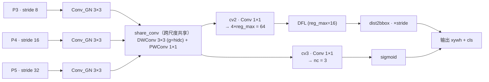

# Insulator_defect · 基于 LSCD 轻量共享检测头的绝缘子缺陷检测

> 基于 **YOLO11** 的绝缘子缺陷检测方案：引入 **LSCD**（Lightweight Shared Convolutional Detection Head，轻量共享卷积检测头），
> 并与 **FasterNet** 主干、**SlimNeck** 颈部结构做完整消融。仓库收录了核心实现代码、消融结果表与全部训练/验证日志。

- 检测类别（3 类）：`insulator`（正常绝缘子）、`broken`（破损）、`pollution-flashover`（污秽/闪络）
- 主数据集：**IDID**（绝缘子缺陷检测数据集），辅助对比：**CPLID**
- 最佳精度配置：Baseline + FasterNet + SlimNeck + LSCD，**mAP50 = 0.8850，mAP50-95 = 0.5749**
- 最佳性价比配置：Baseline + SlimNeck + LSCD，**参数量比基线少 17.4 万，GFLOPs 少 1.1，FPS 反而提升 21.8**

---

## 一、核心方法：LSCD 检测头

### 1.1 结构说明

LSCD 替换了 Ultralytics 原生的 `Detect` / `Segment` 检测头，做了三点改造：

1. **统一投影**：各尺度特征（P3/P4/P5）先经 `Conv_GN` 投影到相同的隐层维度 `hidc`，消除尺度间的通道差异；
2. **跨尺度共享**：所有尺度共用同一个 `share_conv` 块——**深度可分离 3×3 卷积（`g=hidc`）+ 1×1 逐点卷积**，权重在三个尺度间共享，
   用一次卷积替代三套独立卷积，是参数与计算量下降的主要来源；
3. **双分支输出**：回归分支 `cv2`（1×1 卷积 → `4 × reg_max = 64` 通道）与分类分支 `cv3`（1×1 卷积 → `nc = 3` 通道），
   回归量再经 `DFL`（`reg_max = 16`）解码为 `xywh` 框。

### 1.2 结构图



### 1.3 与原生 Detect 头的差异

| 对比项 | 原生 Detect | LSCD（本文） |
| --- | --- | --- |
| 尺度投影 | 各尺度独立 `Conv` | 统一投影到 `hidc` |
| 特征提取 | 三套独立卷积 | **一套跨尺度共享的深度可分离卷积** |
| 权重共享 | 无 | P3/P4/P5 共享 `share_conv` |
| 回归分支 | `cv2` → `4×reg_max` | 同 |
| 分类分支 | `cv3` → `nc` | 同 |
| 分割支持 | `Segment` 继承自 `Detect` | `Segment_LSCD` 同步改造（Proto + cv4） |

实现代码见 [`src/lscd_detect_head.py`](src/lscd_detect_head.py)。

> **代码整理说明**：原始代码片段使用 **NBSP（非断行空格）** 做缩进，Python 无法解析；
> 已统一规范化为标准 4 空格缩进、补齐模块级 `import`，并移除末尾的非代码备注行。
> 当前文件已通过 `py_compile` 语法校验（Python 3.10），可直接 `import` 使用。

---

## 二、消融实验结果

### 2.1 IDID 数据集 · 整体指标

| 实验配置 | 参数量 | GFLOPs | 模型大小 | 推理 FPS | Precision | Recall | mAP50 | mAP50-95 |
| --- | ---: | ---: | ---: | ---: | ---: | ---: | ---: | ---: |
| 基线模型 (YOLO11) | 2,582,737 | 6.3 | 5.2 MB | 414.4 | 0.8984 | 0.7813 | 0.8437 | 0.5502 |
| Baseline + FasterNet | 3,902,349 | 9.2 | 7.8 MB | 347.1 | 0.8528 | 0.8411 | 0.8668 | 0.5658 |
| Baseline + SlimNeck | 2,570,209 | 5.9 | 5.3 MB | 276.1 | 0.8817 | 0.8114 | 0.8511 | 0.5676 |
| Baseline + LSCD | 2,420,622 | 5.6 | 4.9 MB | 377.6 | 0.8820 | 0.7903 | 0.8479 | 0.5573 |
| Baseline + FasterNet + LSCD | 3,740,234 | 8.4 | 7.4 MB | 353.4 | 0.8945 | 0.8499 | 0.8806 | 0.5691 |
| Baseline + SlimNeck + LSCD | 2,408,094 | 5.2 | 4.9 MB | 436.2 | 0.9174 | 0.8032 | 0.8630 | 0.5697 |
| **Baseline + FasterNet + SlimNeck + LSCD** | 3,727,706 | 8.1 | 7.4 MB | 320.8 | **0.9200** | 0.8239 | **0.8850** | **0.5749** |

### 2.2 相对基线的增益（以 mAP50-95 为准）

| 实验配置 | mAP50-95 变化 | 参数量变化 | GFLOPs 变化 | FPS 变化 |
| --- | ---: | ---: | ---: | ---: |
| + FasterNet | +0.0156 | +1,319,612 | +2.9 | −67.4 |
| + SlimNeck | +0.0174 | −12,528 | −0.4 | −138.3 |
| + LSCD | +0.0071 | −162,115 | −0.7 | −36.8 |
| + FasterNet + LSCD | +0.0189 | +1,157,497 | +2.1 | −61.0 |
| + SlimNeck + LSCD | +0.0195 | −174,643 | −1.1 | **+21.8** |
| + FasterNet + SlimNeck + LSCD | **+0.0247** | +1,144,969 | +1.8 | −93.6 |

**结论**：LSCD 单独使用即可带来 **−162,115 参数 / −0.7 GFLOPs** 的开销下降，同时 mAP50-95 提升 **+0.0071**；
与 SlimNeck 组合后精度与速度**双赢**（参数、FLOPs 双降，FPS 反而 +21.8）。

### 2.3 分类别指标（验证集 144 张 / 490 个目标）

| 配置 | 类别 | Precision | Recall | F1 | mAP50 | mAP75 | mAP50-95 |
| --- | --- | ---: | ---: | ---: | ---: | ---: | ---: |
| 基线 | insulator | 0.9976 | 1.0000 | 0.9988 | 0.9950 | 0.9949 | 0.9496 |
| 基线 | broken | 0.8328 | 0.7396 | 0.7834 | 0.8022 | 0.3342 | 0.3952 |
| 基线 | pollution-flashover | 0.8648 | 0.6043 | 0.7115 | 0.7338 | 0.2013 | 0.3060 |
| + FasterNet | insulator | 0.9960 | 1.0000 | 0.9980 | 0.9950 | 0.9950 | 0.9378 |
| + FasterNet | broken | 0.7635 | 0.8406 | 0.8002 | 0.8478 | 0.3982 | 0.4457 |
| + FasterNet | pollution-flashover | 0.7989 | 0.6826 | 0.7362 | 0.7575 | 0.1808 | 0.3138 |
| + SlimNeck | insulator | 0.9899 | 1.0000 | 0.9949 | 0.9950 | 0.9950 | 0.9479 |
| + SlimNeck | broken | 0.8442 | 0.8125 | 0.8280 | 0.8502 | 0.4510 | 0.4456 |
| + SlimNeck | pollution-flashover | 0.8111 | 0.6217 | 0.7039 | 0.7081 | 0.2166 | 0.3093 |
| + LSCD | insulator | 0.9897 | 1.0000 | 0.9948 | 0.9950 | 0.9950 | 0.9449 |
| + LSCD | broken | 0.8107 | 0.7708 | 0.7903 | 0.8295 | 0.4052 | 0.4204 |
| + LSCD | pollution-flashover | 0.8456 | 0.6000 | 0.7019 | 0.7193 | 0.2204 | 0.3066 |
| + FasterNet + LSCD | insulator | 0.9914 | 1.0000 | 0.9957 | 0.9950 | 0.9940 | 0.9432 |
| + FasterNet + LSCD | broken | 0.8515 | 0.8542 | 0.8528 | 0.8744 | 0.3941 | 0.4441 |
| + FasterNet + LSCD | pollution-flashover | 0.8405 | 0.6957 | 0.7612 | 0.7724 | 0.1983 | 0.3199 |
| + SlimNeck + LSCD | insulator | 0.9981 | 1.0000 | 0.9991 | 0.9950 | 0.9948 | 0.9460 |
| + SlimNeck + LSCD | broken | 0.8774 | 0.7917 | 0.8323 | 0.8558 | 0.4417 | 0.4579 |
| + SlimNeck + LSCD | pollution-flashover | 0.8766 | 0.6179 | 0.7249 | 0.7382 | 0.2038 | 0.3051 |
| + FasterNet + SlimNeck + LSCD | insulator | 0.9945 | 1.0000 | 0.9973 | 0.9950 | 0.9950 | 0.9457 |
| + FasterNet + SlimNeck + LSCD | broken | 0.8596 | 0.8021 | 0.8298 | 0.8704 | 0.4326 | **0.4577** |
| + FasterNet + SlimNeck + LSCD | pollution-flashover | 0.9059 | 0.6697 | 0.7701 | 0.7894 | 0.1852 | **0.3213** |

> 完整配置 `broken` 类 mAP50-95 达到 **0.4577**（基线 0.3952，+0.0625），
> `pollution-flashover` 类达到 **0.3213**（基线 0.3060，+0.0153）——
> 小样本、遮挡严重的缺陷类别受益最明显。

### 2.4 CPLID 数据集 · 整体指标

| 实验配置 | 参数量 | GFLOPs | 模型大小 | 推理 FPS | Precision | Recall | mAP50 | mAP50-95 |
| --- | ---: | ---: | ---: | ---: | ---: | ---: | ---: | ---: |
| 基线模型 (YOLO11) | 2,582,542 | 6.3 | 5.2 MB | 318.8 | 0.9824 | 0.9865 | 0.9924 | 0.8254 |
| Baseline + FasterNet | 3,902,154 | 9.2 | 7.8 MB | 278.8 | 0.9755 | 0.9885 | 0.9904 | 0.8009 |
| Baseline + SlimNeck | 2,570,014 | 5.9 | 5.2 MB | 318.6 | 0.9790 | 0.9846 | 0.9913 | 0.8219 |
| Baseline + LSCD | 2,420,557 | 5.6 | 4.9 MB | 358.1 | 0.9787 | 0.9903 | **0.9931** | 0.8072 |
| Baseline + FasterNet + LSCD | 3,740,169 | 8.4 | 7.4 MB | 300.6 | 0.9792 | 0.9879 | 0.9924 | 0.8085 |
| Baseline + SlimNeck + LSCD | 2,408,029 | 5.2 | 4.9 MB | 317.5 | 0.9804 | 0.9865 | 0.9929 | 0.8086 |
| Baseline + FasterNet + SlimNeck + LSCD | 3,727,641 | 8.1 | 7.4 MB | 285.6 | 0.9654 | 0.9900 | 0.9925 | 0.8026 |

> CPLID 上各配置 mAP50 普遍在 0.99 以上、mAP50-95 在 0.80~0.83 区间波动，
> 差异较小，说明 CPLID 相对易分；IDID 才是区分各结构优劣的主要依据。

---

## 三、目录结构

```
Insulator_defect/
├── README.md                          # 本文档
├── .gitignore                         # 隐私 / 备份 / 权重等忽略规则
├── src/
│   └── lscd_detect_head.py            # LSCD 检测头实现（Detect_LSCD / Segment_LSCD）
└── experiments/
    ├── ablation_results/              # 消融结果汇总（去重后仅保留一份）
    │   ├── ablation_summary_latest.md    # Markdown 版汇总表 + 增益分析
    │   ├── ablation_summary_latest.csv   # 机器可读全指标表
    │   ├── ablation_summary_latest.txt   # 等宽表格版
    │   └── ablation_summary_cplid_latest.txt  # CPLID 数据集对应结果
    └── ablation_logs/                 # 训练 / 验证日志（已脱敏）
        ├── ablation_train_*.log          # 批量消融训练脚本运行日志
        ├── ablation_val_*.log            # 批量验证脚本运行日志
        ├── train_<配置>_<时间戳>.log      # 各配置训练日志
        └── val_<配置>_<时间戳>.log        # 各配置验证 + 论文指标导出日志
```

**去重说明**：原始材料中同一份结果存在多份副本（`ablation_summary_latest.*` 与
`ablation_summary_20260103_074329.*` 内容完全一致），仓库内只保留 `_latest` 一份；
压缩包（`*.7z`）与解压目录不同时收录，避免同一内容重复占用仓库。

---

## 四、运行环境与复现

### 4.1 训练环境

| 项 | 值 |
| --- | --- |
| Ultralytics | 8.3.9 |
| Python | 3.10.16 |
| PyTorch | 2.2.2+cu121 |
| GPU | NVIDIA GeForce RTX 4090 (24 GB) |
| 模型规模 | `n`（日志提示 `no model scale passed. Assuming scale='n'`） |

### 4.2 关键训练超参（取自日志中的 `trainer` 参数）

| 参数 | 值 | 参数 | 值 |
| --- | --- | --- | --- |
| epochs | 200 | patience | 100 |
| batch | 32 | imgsz | 640 |
| optimizer | SGD | lr0 / lrf | 0.01 / 0.01 |
| momentum | 0.937 | weight_decay | 0.0005 |
| warmup_epochs | 3.0 | seed | 0（deterministic=True） |
| mosaic | 1.0 | mixup | 0.0 |
| fliplr | 0.5 | degrees / translate / scale | 0.0 / 0.1 / 0.5 |
| amp | True | cache | True |
| nc（类别数） | 3（由 `yolo11.yaml` 的 80 覆盖为 3） | export format | torchscript + simplify |

### 4.3 复现步骤

```bash
# 1. 安装依赖
pip install ultralytics==8.3.9

# 2. 替换检测头：将 src/lscd_detect_head.py 中的 Detect_LSCD / Segment_LSCD
#    接入 ultralytics/nn/modules/head.py，并在各模型 yaml 中引用

# 3. 准备数据集（IDID，nc=3）与 dataset/IDID.yaml

# 4. 训练
yolo detect train model=ultralytics/cfg/models/11/yolo11.yaml data=dataset/IDID.yaml \
    epochs=200 batch=32 imgsz=640 device=0

# 5. 验证并导出论文指标
yolo detect val model=runs/IDID/yolo11n-<配置>/weights/best.pt data=dataset/IDID.yaml
```

> 数据集与模型权重未包含在本仓库中（见 `.gitignore`），需自行获取与训练。

---

## 五、日志说明

### 5.1 命名规则

- `train_<配置名>_<时间戳>.log`：单个配置的完整训练日志
- `val_<配置名>_<时间戳>.log`：单个配置的验证日志，末尾附带 **论文指标表**（`Model Metrice`）
- `ablation_train_<时间戳>.log` / `ablation_val_<时间戳>.log`：批量消融脚本的调度日志

配置名与消融表一一对应：`baseline` / `fasternet` / `slimneck` / `LSCD` / `fasternet-LSCD` /
`slimneck-LSCD` / `fasternet-slimneck-LSCD`。

### 5.2 脱敏处理

日志为原始训练输出，**服务器绝对路径已做占位符替换**：

| 原始路径（训练服务器绝对路径） | 仓库中 |
| --- | --- |
| `/home/<用户>/ultralytics-yolo11-main` | `<ULTRALYTICS_ROOT>` |
| `/home/<用户>/IDID`（数据集目录） | `<DATASET_ROOT>` |

其余内容（模型结构表、训练曲线、验证指标、GPU 型号等）保持原样，未作删改。

### 5.3 已知情况

- `train_baseline_20260102_231155.log` 是基线的**首次运行**，在 **epoch 53/200** 处中断；
  其余 7 份训练日志均完整跑满 200 epoch。基线最终结果以
  `train_baseline_20260102_232416.log` 与对应 `val_baseline_*.log` 为准。
- 训练过程中若干次启动失败（`ModuleNotFoundError: No module named 'cv2'`）产生的空日志**未收录**，
  失败情况保留在 `ablation_train_*.log` 的调度记录中。
- `val_*.log` 中的 `runs/val/...` 为验证输出目录（相对路径），保留便于对照。

---

## 六、隐私与未上传内容说明

为避免个人信息外泄，以下内容**仅保留在本地，未包含在本仓库中**（相关规则已写入 `.gitignore`）：

| 类别 | 具体内容 | 原因 |
| --- | --- | --- |
| 会议投稿 / 汇报材料 | `ICEAAI_2026-海报.png`、汇报 PPTX（随机名）、会议投稿登记表（`.doc`） | 含姓名、单位、通讯作者电话邮箱、会议组委会联系方式 |
| 个人身份文件 | 以学号命名的 `.docx`、以随机 UUID 命名的 `.docx` | 文件名/元数据直接暴露个人身份信息 |
| 第三方参考论文 | `参考论文1.docx`、`参考论文2.docx` | 他人版权作品，不随仓库分发 |
| 第三方投稿模板 | `Conference-LaTeX-template_10-17-19/`（`IEEEtran.cls`、`conference_101719.tex/pdf`） | IEEE / SPIE 官方模板，版权归原作者 |
| 本地压缩包与备份 | `*.7z`、`备份/` 目录 | 与仓库内容重复，避免重复入库 |

> 上表刻意不写出具体文件名与编号——**列出编号等于再次泄露**。
> 精确匹配规则写在 `.gitignore` 中，同样采用位数/扩展名等泛化规则，不含具体学号或标识串。
>
> Office 文档内嵌的作者元数据（如 `dc:creator`、`cp:lastModifiedBy`）同样属于个人信息，
> 因此相关文档整体排除在外，而非仅做字段擦除。
> 训练日志中的服务器路径虽不含个人身份信息，但仍可能暴露内部环境结构，故统一做占位符替换。

---

## 七、许可

本仓库暂未附带 `LICENSE` 文件。代码部分基于 **Ultralytics YOLO11** 二次开发，
遵循其原始许可证（AGPL-3.0）；日志与实验数据由本项目产生。
正式对外发布前请补充明确的许可证文件。

---

## 八、引用

如果本工作对您的研究有帮助，欢迎引用本仓库并反馈改进建议。
